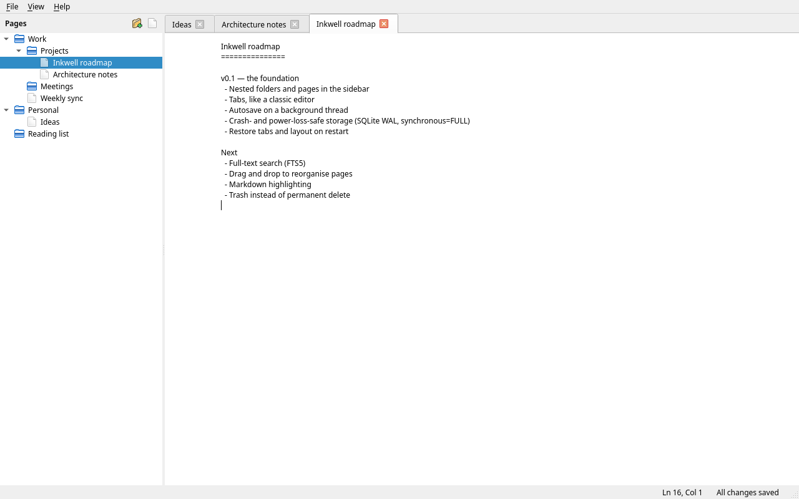

<div align="center">


# Inkwell

**A fast, native notes app that never loses what you wrote.**

[](https://github.com/Shezitt/inkwell/actions/workflows/ci.yml)
[](LICENSE)


</div>

Inkwell combines the snappy, tabbed editing of a classic desktop text editor
such as Kate with a Notion-style sidebar of nested folders and pages. It is
written in C++20 with Qt 6.



## Features

- **Nested folders and pages.** Organise notes in a tree of folders of any
  depth, Notion style. Every page lives in a folder.
- **Your order, not the alphabet's.** Drag pages and folders to reorder them or
  to move them into another folder, or nudge the selected one with
  <kbd>Ctrl</kbd>+<kbd>Shift</kbd>+<kbd>↑</kbd>/<kbd>↓</kbd>.
- **Tabs.** Open as many pages as you like side by side, reorder them, and
  switch with <kbd>Ctrl</kbd>+<kbd>Tab</kbd>.
- **Quick switcher.** Press <kbd>Ctrl</kbd>+<kbd>P</kbd>, type a few letters
  of a page's name, press <kbd>Enter</kbd>. Matching is fuzzy, so `fbs` finds
  "Feedback for Sav".
- **Zoom.** Make the text bigger or smaller with <kbd>Ctrl</kbd>+<kbd>+</kbd>
  and <kbd>Ctrl</kbd>+<kbd>-</kbd>, or <kbd>Ctrl</kbd> and the mouse wheel, in
  all tabs at once; <kbd>Ctrl</kbd>+<kbd>0</kbd> resets it. Inkwell remembers
  the size.
- **Markdown, formatted as you type.** Headings, **bold**, *italic*, `code`,
  lists, task lists, quotes and links are styled in colours that follow your
  theme. The syntax, such as `**` or a link's URL, shows only on the line
  you're editing, so the rest reads like a formatted page: lists get bullets,
  tasks get checkboxes you can click, quotes get a bar and `---` becomes a
  line. <kbd>Ctrl</kbd>+click a link to open it. Notes stay plain text;
  both are settings under View.
- **Trash.** Deleting a page or folder moves it to the Trash, at the bottom of
  the sidebar, where you can restore it or delete it for good.
- **Full-text search.** <kbd>Ctrl</kbd>+<kbd>Shift</kbd>+<kbd>F</kbd> finds the
  pages containing the words you type, as you type, with the matching line
  shown. Case and accents don't matter, so `cache` finds "Caché". Pick a result
  to jump straight to the match.
- **Autosave you never have to think about.** There's no Save button to
  remember. Edits are written to disk shortly after you pause, and at least
  every two seconds while you type.
- **Crash- and power-loss-safe.** Notes are stored in SQLite with a fsynced
  write-ahead log. Closing the app, a crash, `kill`, logging out or pulling the
  power cord costs at most a moment of typing, never a corrupted notebook.
  [How it works →](docs/ARCHITECTURE.md#durability)
- **Picks up where you left off.** Open tabs, cursor and scroll positions,
  expanded folders and the window layout are restored on restart, even after
  a crash.
- **Fast.** Native code, all disk I/O on a background thread, an in-memory
  tree, and page contents loaded only when opened.
  [Details →](docs/ARCHITECTURE.md#performance)

## Getting started

### Build from source

You need a C++20 compiler, CMake ≥ 3.21 and Qt ≥ 6.4 (Widgets and Sql, with
the SQLite driver; its SQLite needs FTS5, which every major distribution
enables).

<details open>
<summary>Debian / Ubuntu</summary>

```sh
sudo apt install build-essential cmake qt6-base-dev libqt6sql6-sqlite libgl-dev
```
</details>

<details>
<summary>Fedora</summary>

```sh
sudo dnf install gcc-c++ cmake qt6-qtbase-devel
```
</details>

<details>
<summary>Arch Linux</summary>

```sh
sudo pacman -S base-devel cmake qt6-base
```
</details>

Then:

```sh
git clone https://github.com/Shezitt/inkwell.git
cd inkwell
cmake --preset release
cmake --build --preset release
./build/release/src/inkwell
```

To install it system-wide, with a launcher entry and icon:

```sh
sudo cmake --install build/release
```

### Where are my notes?

Everything lives in a single SQLite file in your user data directory, for
example `~/.local/share/Inkwell/inkwell.sqlite3` on Linux. To use another file,
for instance on a synced folder, start Inkwell with
`inkwell --database /path/to/notes.sqlite3`.

## Keyboard shortcuts

| Action                     | Shortcut                                        |
| -------------------------- | ----------------------------------------------- |
| New page                   | <kbd>Ctrl</kbd>+<kbd>N</kbd>                     |
| New folder                 | <kbd>Ctrl</kbd>+<kbd>Shift</kbd>+<kbd>N</kbd>     |
| Go to page                 | <kbd>Ctrl</kbd>+<kbd>P</kbd>                     |
| Search in all pages        | <kbd>Ctrl</kbd>+<kbd>Shift</kbd>+<kbd>F</kbd>     |
| Rename (in the sidebar)    | <kbd>F2</kbd>                                    |
| Move to Trash (in the sidebar) | <kbd>Delete</kbd>                            |
| Move up / down (in the sidebar) | <kbd>Ctrl</kbd>+<kbd>Shift</kbd>+<kbd>↑</kbd> / <kbd>Ctrl</kbd>+<kbd>Shift</kbd>+<kbd>↓</kbd> |
| Save now                   | <kbd>Ctrl</kbd>+<kbd>S</kbd> (optional)          |
| Close tab                  | <kbd>Ctrl</kbd>+<kbd>W</kbd>                     |
| Next / previous tab        | <kbd>Ctrl</kbd>+<kbd>Tab</kbd> / <kbd>Ctrl</kbd>+<kbd>Shift</kbd>+<kbd>Tab</kbd> |
| Toggle sidebar             | <kbd>Ctrl</kbd>+<kbd>B</kbd>                     |
| Zoom in / out              | <kbd>Ctrl</kbd>+<kbd>+</kbd> / <kbd>Ctrl</kbd>+<kbd>-</kbd>, or <kbd>Ctrl</kbd>+wheel |
| Reset zoom                 | <kbd>Ctrl</kbd>+<kbd>0</kbd>                     |
| Open a link                | <kbd>Ctrl</kbd>+click                            |

## Roadmap

v0.1 lays the foundation. Ideas for what comes next:

- [x] Full-text search across all pages (SQLite FTS5)
- [x] Drag and drop to reorder and move pages and folders
- [x] Markdown syntax highlighting
- [x] Markdown syntax hidden outside the line being edited
- [x] Bullets, clickable task checkboxes, rules and quote bars drawn in place
- [x] <kbd>Ctrl</kbd>+click to open links
- [x] Trash, instead of permanent delete
- [x] Quick switcher (<kbd>Ctrl</kbd>+<kbd>P</kbd>) to open pages by name
- [ ] Dark theme and font settings
- [ ] Import and export (Markdown files)
- [ ] Windows and macOS builds in CI

Have an idea? [Open a feature request](https://github.com/Shezitt/inkwell/issues/new/choose).

## Contributing

Contributions are very welcome! Please read [CONTRIBUTING.md](CONTRIBUTING.md)
for how to build, test, and format code, and for the branch and commit
conventions. For an overview of how the code is organised, start with
[docs/ARCHITECTURE.md](docs/ARCHITECTURE.md).

## License

Inkwell is released under the [MIT License](LICENSE).
