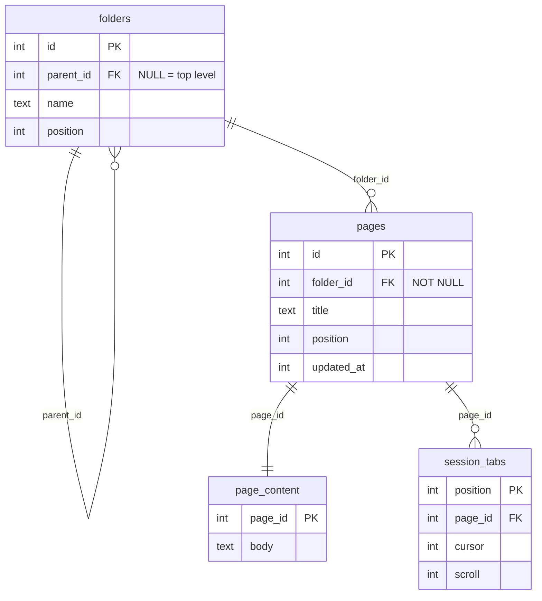
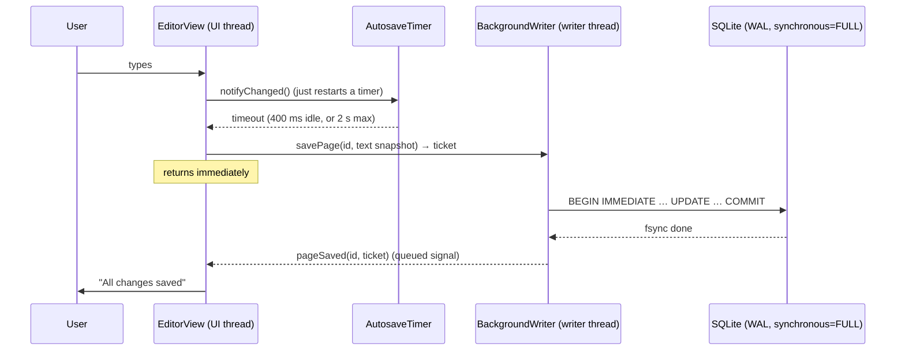

# Architecture

Inkwell has two goals that shape every design decision:

1. **Never lose what the user wrote**, not after a crash, a forced quit or a
   power cut.
2. **Never make the user wait.** Typing, switching tabs and browsing the tree
   must feel instant, whatever the size of the notebook or the speed of the
   disk.

This document explains how the code achieves both. It is meant for
contributors; see the [README](../README.md) for user-facing documentation.

## Layout

```
src/
├── core/   Storage and logic. Qt Core + Qt Sql only, no widgets. Fully unit-tested.
├── ui/     Qt Widgets front end: models, views and the main window.
└── app/    main(): startup, single-instance lock, signal handling.
tests/      One Qt Test executable per component, plus end-to-end tests.
data/       Desktop entry, icon, and the font that hides Markdown syntax.
tools/      Scripts that generate files in data/.
```

`core` must never depend on Qt Widgets. That keeps the logic testable without
a GUI and leaves the door open to other front ends.

| Component                  | Responsibility                                                     |
| -------------------------- | ------------------------------------------------------------------ |
| `core/Database`            | One SQLite connection per thread, configured for durability        |
| `core/Schema`              | Versioned migrations through `PRAGMA user_version`                 |
| `core/NoteStore`           | CRUD, moves and full-text search; loads page bodies on demand      |
| `core/FuzzyMatch`          | Scores quick-switcher matches of a pattern against page titles     |
| `core/MarkdownSyntax`      | Finds Markdown in a line, carrying fenced-code state across lines  |
| `core/Session`             | Persists open tabs, cursor positions and window layout             |
| `core/BackgroundWriter`    | Writes page bodies and the session on a dedicated thread           |
| `core/AutosaveTimer`       | Decides *when* an edited page should be saved                      |
| `ui/PageTreeModel`         | In-memory folder/page tree exposed as a `QAbstractItemModel`       |
| `ui/NavigationPane`        | Sidebar: create, rename, delete folders and pages                  |
| `ui/EditorView`            | Plain-text editor for one page; hands snapshots to the writer      |
| `ui/MarkdownHighlighter`   | Turns Markdown spans into theme-aware formats; hides syntax        |
| `ui/EditorArea`            | Tabs; one `EditorView` per open page                               |
| `ui/SearchPopup`           | Base of the search popups: input, results, keyboard handling       |
| `ui/QuickSwitcher`         | Ctrl+P: open a page by (fuzzy) name                                |
| `ui/PageSearch`            | Ctrl+Shift+F: full-text search, with snippets                      |
| `ui/TrashDialog`           | Restores or permanently deletes what is in the trash               |
| `ui/MainWindow`            | Wires everything together; session save/restore; status bar        |
| `app/TerminationSignals`   | Turns SIGTERM/SIGINT/SIGHUP into a graceful, saving shutdown       |

## Data model



- Folders form a tree of any depth. Every page belongs to exactly one folder.
- All foreign keys use `ON DELETE CASCADE`. Deleting a folder removes its
  subfolders, their pages, their bodies and any session tabs pointing at them,
  all in one statement.
- **Page bodies live in their own table.** Listing the tree reads only the
  small `folders` and `pages` rows and never touches note contents, however
  large they get.
- `session_values` (not shown) is a key/value table for the window layout.
- `trashed_at` (not shown) on `folders` and `pages` marks items in the trash.
  They keep their place and content; everything inside a trashed folder is
  hidden with it without being marked. Queries for the tree, moves and search
  only see folders reachable without passing through a trashed one.
- `page_search` (not shown) is an FTS5 full-text index of titles and bodies,
  keyed by page id. Triggers on `pages` and `page_content` update it in the
  same transaction as every insert, rename, edit and delete, so it can never
  drift from the notes, not even after a crash. It costs a second copy of the
  text, which is small for notes.

Migrations live in `core/Schema.cpp`. Each runs in its own transaction, so an
upgrade interrupted halfway leaves the previous, consistent version. Inkwell
refuses to open a database written by a *newer* version instead of corrupting
it. **Never edit a released migration; append a new one.**

## Durability

Saving a page goes through these steps:



The guarantees come from three layers:

1. **SQLite in WAL mode with `synchronous=FULL`.** A transaction that has
   committed has been fsynced to the write-ahead log. It survives an
   application crash *and* an OS crash or power loss, given hardware that
   honours fsync. An interrupted transaction is rolled back on the next open,
   so a write is never left half done.
2. **Saving often, without blocking.** `AutosaveTimer` saves after a 400 ms
   pause, and at least every 2 s during continuous typing. Pages are also
   saved when an editor loses focus, when a tab closes and when the app quits.
   In the worst case, about two seconds of typing are at risk.
3. **Honest status.** Every `savePage()` returns a *ticket*. The editor counts
   as clean only once the writer reports that ticket durable, so "All changes
   saved" in the status bar means the text is on disk.

The session (open tabs, cursor positions, layout) uses the same path: it is
saved 1 s after any change, so a crash reopens the same tabs.

Shutdown paths that skip `closeEvent` are covered too:

- **SIGTERM / SIGINT / SIGHUP**: a self-pipe hands the signal to the event
  loop, which saves everything and quits normally (`app/TerminationSignals`).
- **Desktop logout**: `QGuiApplication::commitDataRequest` triggers the same save.
- **A second instance** on the same notebook is refused with a `QLockFile`.
  Otherwise two windows would overwrite each other's edits. Stale locks from a
  crashed instance are detected by PID and taken over.

These guarantees are tested, not just claimed. `tst_crashrecovery` runs a
process that saves continuously, **SIGKILLs it at random moments**, then checks:

- `PRAGMA integrity_check` returns `ok`
- every acknowledged save is present
- no save is torn

`tst_shutdown` sends SIGTERM to the real app and checks that it exits cleanly
with its session saved.

## Hiding Markdown syntax

Outside the line with the cursor, the editor hides syntax such as `**` and
the URL of a link, so notes read like formatted text. The text never changes:
what is saved, copied and searched is exactly what was typed.

- `MarkdownSyntax` marks the characters that may be hidden as `Hideable`
  spans, in addition to the spans that drive highlighting.
- `MarkdownHighlighter` draws them in *Inkwell Blank*, a font in which every
  character is blank and has no width. A plain-text document cannot hide
  characters, and the alternatives fall short: a transparent colour shows
  again in a selection, which draws text in its own colour, and a near-zero
  font size makes Qt search the fallback fonts on disk for every hidden
  character. The font is 668 bytes, generated by `tools/make-blank-font.py`
  and bundled as a Qt resource.
- `EditorView` reveals the line with the cursor. After a click it waits for
  the double-click interval to pass: revealing moves the text, which would
  otherwise move the word a double-click is meant to select.

## Performance

- **No disk I/O on the UI thread while editing.** `BackgroundWriter` owns a
  dedicated thread and its own SQLite connection. The UI thread only copies a
  `QString`, which is implicitly shared, so the copy is cheap.
- **Coalescing and batching.** If a page is saved several times before the
  writer gets to it, only the latest text is written. Everything waiting is
  committed in one transaction, which means one fsync for many saves.
- **The tree lives in memory.** `PageTreeModel` loads names once at startup
  and is then updated incrementally after each store operation, without
  re-querying. Views never wait on the database while scrolling or expanding,
  and `setUniformRowHeights` spares the view from measuring every row.
- **Bodies are loaded lazily**, only when a page is opened.
- **Highlighting is incremental.** Qt re-highlights only the edited line (and
  following ones while a fenced code block's state changes): a few microseconds
  per keystroke, about 40 ms for a 10,000-line page when it opens. Hiding
  syntax adds about 60% to that; moving the cursor to another line
  re-highlights just the line it leaves and the one it enters.
- **Search never scans the notes.** The quick switcher matches the page names
  already in memory: about 5 ms for 10,000 pages per keystroke. Full-text
  search asks the FTS5 index: 6-10 ms per keystroke for 5,000 pages of 2 KB.
- **`QPlainTextEdit`** is Qt's text widget for large documents; its layout is
  incremental and per block.
- **WAL lets reads and writes run concurrently.** The UI connection can read a
  page while the writer thread is committing.

### Threading rules

- A `Database` (and anything using it, such as `NoteStore`) belongs to the
  thread that opened it. Never share one across threads.
- The UI thread owns the main connection and uses it for reads and for rare,
  user-initiated structural changes (create, rename, delete).
- The writer thread owns its own connection and handles all frequent writes.
- Before loading a page body, `EditorArea` calls `BackgroundWriter::flush()`
  so it never reads text older than a save still in the queue.

## Testing

Every component in `core` and `ui` has a Qt Test executable in `tests/`:

```sh
ctest --preset dev     # all tests
ctest --preset asan    # same, under AddressSanitizer + UBSan
```

UI tests run with `QT_QPA_PLATFORM=offscreen`. `PageTreeModel` is checked with
`QAbstractItemModelTester` for every structural change. CI builds with GCC
and Clang in both configurations, against the oldest supported Qt (6.4).
